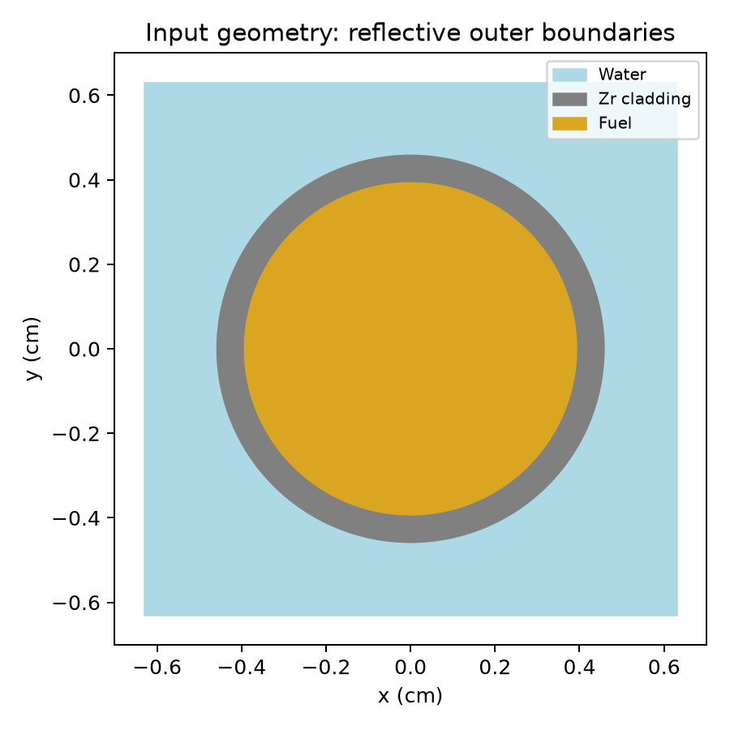
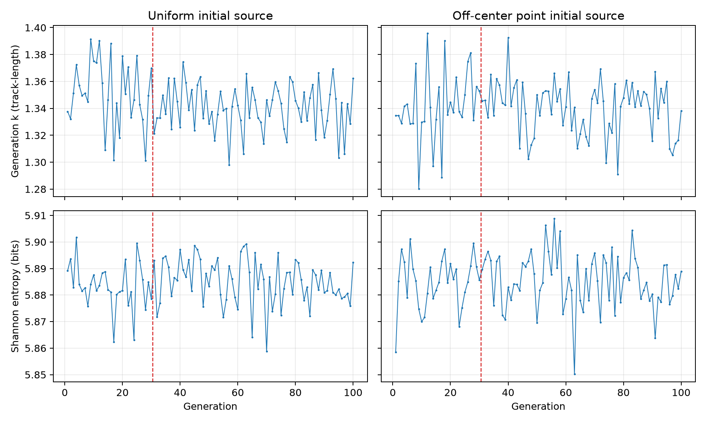
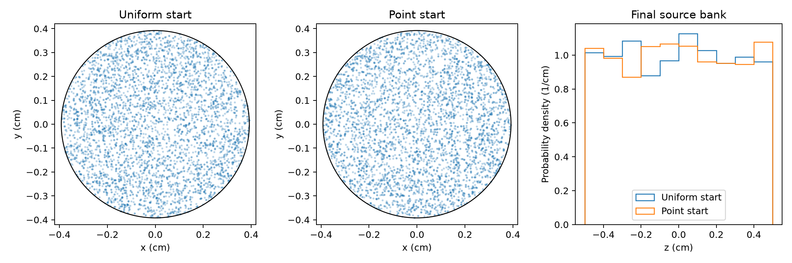
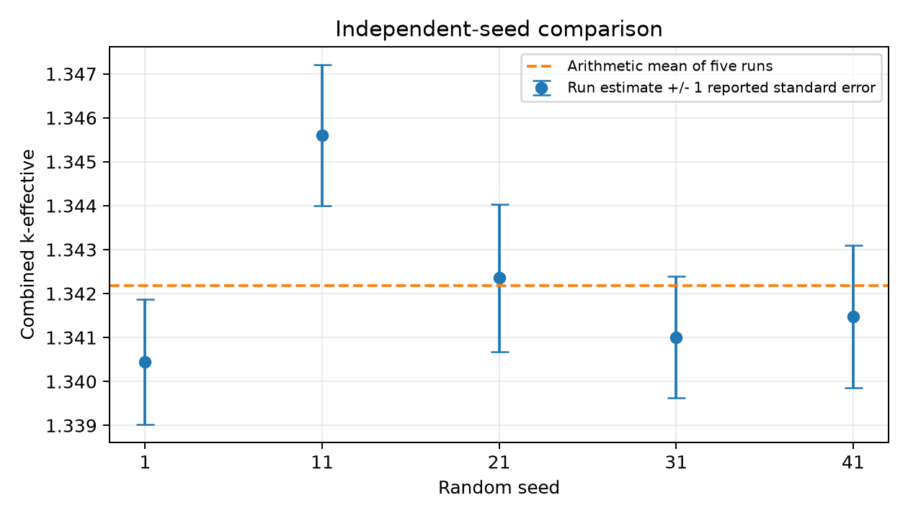

# Lab 01 - Reflective Pin Cell: Materials, Geometry, and Source Convergence

Series: **OpenMC Learning Lab**. Archived: **2026-10-11**.
Status: completed numerical experiment.

## Question

How do initial source shape, inactive batches, and random seed affect the
eigenvalue and source-convergence diagnostics of a cold UO2-water pin cell?

The experiment checks material number densities and Boolean geometry, then
compares source entropy, source-bank snapshots, and eigenvalue estimates.
No experimental reactor benchmark is used.

## Main result

For the five point-source runs with 100 inactive and 70 active batches:

- Arithmetic mean k: **1.34217675**.
- Sample standard deviation between runs: **0.00203496**.
- Empirical standard error of their mean: **0.00091006**.
- RMS of the five reported single-run standard errors: **0.00154459**.

The diagnostics did not show an obvious late source-entropy drift or persistent
localization at the initial point. These observations are consistent with rapid
source redistribution in this model. They do not prove exact source convergence,
calibration of the reported uncertainty, or physical validity against experiment.

## Model and nuclear data

| Quantity | Value |
|---|---|
| Fuel radius | 0.39218 cm |
| Cladding outer radius | 0.45720 cm |
| Square pitch | 1.26 cm |
| Axial height | 1.0 cm, centered at z = 0 |
| Outer boundary conditions | Reflective on all six faces |
| Fuel mass density | 10.29769 g/cm3 |
| Cladding mass density | 6.55 g/cm3 |
| Water mass density | 1.0 g/cm3, no boron |
| Material temperature | 293.6 K |
| Thermal scattering | c_H_in_H2O in water |
| Nuclear data | ENDF/B-VII.1 NNDC HDF5 pin-cell subset |
| Solver | OpenMC 0.16.0, continuous-energy neutron eigenvalue mode |

The fuel and cladding touch: no gap is modeled. The 1 cm axial segment with
reflective end faces represents an ideal repeated medium, not a 1 cm high real
reactor core. A zero leakage fraction is expected from the imposed boundaries;
it is not an independent validation of the material model. A k above one
describes multiplication in this idealized model, not a prediction for a full
finite reactor.



The figure is a schematic drawn from the input dimensions. An OpenMC geometry
slice was also inspected, and transport runs used geometry debugging.

Material coefficients are relative atom amounts (`ao`):

| Material | Nuclide coefficients |
|---|---|
| Water | H1: 2; O16: 1 |
| Fuel | U234: 4.4843e-6; U235: 5.5815e-4; U238: 2.2408e-2; O16: 4.5829e-2 |
| Cladding | Zr90: 0.021827; Zr91: 0.00476; Zr92: 0.0072758; Zr94: 0.0073734; Zr96: 0.0011879 |

The existing data subset contains H1, O16, U234/235/238, Zr90/91/92/94/96,
B10/B11, and the water thermal-scattering table. Boron data are present but are
not used in this model. The data are not bundled; their identities, temperature
labels, sizes, and SHA-256 digests are in
[nuclear_data_manifest.json](results/nuclear_data_manifest.json).
The local subset was obtained from the
[ENDF-B-VII.1-NNDC HDF5 distribution](https://github.com/openmc-data-storage/ENDF-B-VII.1-NNDC).
The [OpenMC data tools](https://github.com/openmc-dev/data) describe other
processing routes. Different processing or data temperatures can change results.
No ENDF/B-VIII.1 comparison was performed.

## Material and geometry checks

At water density 1.0 g/cm3, the number densities were:

| Nuclide | Original, atom/(barn cm) | At half density, atom/(barn cm) | Ratio |
|---|---:|---:|---:|
| H1 | 6.687343e-2 | 3.343671e-2 | 0.500 |
| O16 | 3.343671e-2 | 1.671836e-2 | 0.500 |

At fixed composition, halving mass density halves nuclide number density.
At a specified energy and temperature, a microscopic cross section does not
halve with material density; the macroscopic cross section N*sigma does.
Reaction rates in a new transport solution need not halve because the flux can
also change.

The fuel coefficients give O/U = **1.995113**, a U235 atom fraction within uranium
of **2.429841%**, and a U235 mass fraction within uranium of **2.399894%**.
The uranium-fraction denominator excludes oxygen. The supplied coefficients do
not give exactly stoichiometric O/U = 2. All runs use the coefficients listed
above without adjustment.

| Region | Analytic volume, cm3 |
|---|---:|
| Fuel | 0.48319314 |
| Cladding | 0.17349976 |
| Water | 0.93090711 |
| Sum / outer box | 1.58760000 |

Volumes were calculated from pi*r^2*h and the square-cell remainder, not from a
stochastic volume calculation. Region-membership checks assigned (0,0,0) to
fuel, (0.42,0,0) to cladding, and both (0.5,0,0) and (0.62,0.62,0) to water.
The point (0.7,0,0) lies outside the cell. Exact regenerated values are in
[model_checks.json](results/tables/model_checks.json).

## Experiment design

All runs used 5000 particles per generation, one generation per batch, four
threads, and geometry debugging. Both initial-source choices used isotropic
directions, an initial energy of 2 MeV, and a fissionable-material constraint.
The box source becomes uniform within the fuel after rejection of nonfuel
positions. The point source starts at (0.30, 0.0, 0.35) cm.

| Case | Initial source | Inactive / total batches | Seed | Changed factor |
|---|---|---:|---:|---|
| baseline | Box | 30 / 100 | 1 | First eigenvalue run |
| uniform-i30-s1 | Box | 30 / 100 | 1 | Entropy diagnostic enabled |
| point-i30-s1 | Point | 30 / 100 | 1 | Initial spatial source |
| point-i100-s1 | Point | 100 / 170 | 1 | Inactive batches, holding active batches at 70 |
| point-i100-s11 | Point | 100 / 170 | 11 | Random seed |
| point-i100-s21 | Point | 100 / 170 | 21 | Random seed |
| point-i100-s31 | Point | 100 / 170 | 31 | Random seed |
| point-i100-s41 | Point | 100 / 170 | 41 | Random seed |

The last three seeds were selected together after the seed-11 discrepancy and
all were retained. The baseline and entropy-enabled box runs are not independent
replicates. Neither are comparisons that simply reuse the same random seed.
Only the five point-source runs with 100 inactive batches enter the replicate
statistics.

The entropy mesh is 4 x 4 x 4 over the fuel bounding box:
[-0.39218, 0.39218] cm in x and y, and [-0.5, 0.5] cm in z.
It bins source sites; it does not discretize the transport geometry. Some mesh
cells only partially intersect the circular fuel cross section.

## Results and analysis

### Source convergence



Each upper-panel point is one generation's track-length k estimate, not the
cumulative mean or Combined k. The dashed line separates inactive and active
generations. Crossing it changes accumulation of statistics, not the transport
physics.

The box-source active mean entropy was **5.885088** bits. The point-source value
was **5.885507** bits. For the point-source run the first two entropies were
**5.858455** and **5.885196** bits: the visible transient was short. The first
plotted entropy is measured after the first generation produces fission sites;
it is not the entropy of the prescribed initial point.

Shannon entropy H = -sum(p_i log2(p_i)) summarizes mesh-bin fractions. A stable
distribution still produces noisy estimates with finite particles. Equal
entropy does not uniquely identify equal distributions, and increasing entropy
is not itself the goal. The diagnostic and the need to examine both source and
k behavior are described in the
[OpenMC eigenvalue methods](https://docs.openmc.org/en/stable/methods/eigenvalue.html).



Each scatter plot projects all 5000 final source sites onto xy; it is not a
z = 0 slice or an average over all active batches. The z histogram is normalized
as a probability density in 1/cm, so its area is one. The point-source result
was no longer visibly concentrated at the starting point. Approximate axial
uniformity is consistent with an axially uniform model and reflecting end faces.
The plots do not establish a perfectly uniform radial source density.

### Inactive batches

With point initialization and seed 1:

| Inactive batches | Active batches | Combined k +/- 1 reported standard error |
|---:|---:|---:|
| 30 | 70 | 1.339937 +/- 0.001347 |
| 100 | 70 | 1.340447 +/- 0.001421 |

The center values differ by about 0.000510. No large shift was observed when
delaying active scoring. Because these runs reused a seed,
this is a controlled diagnostic comparison, not a strict independent-sample
significance test. One hundred inactive batches are retained as a conservative
setting for this model, not a universal setting.

### Independent seeds



| Seed | Combined k | Reported standard error |
|---:|---:|---:|
| 1 | 1.34044704 | 0.00142123 |
| 11 | 1.34559579 | 0.00160478 |
| 21 | 1.34235291 | 0.00167311 |
| 31 | 1.34100800 | 0.00138630 |
| 41 | 1.34147999 | 0.00161630 |

Seed 11 differs from seed 1 by 0.00514875. Treating the runs as independent and
using their reported standard errors gives an uncertainty of the difference
sqrt(s1^2 + s11^2) = 0.00214364, or **2.40 combined standard errors**. This is
unusual enough to investigate but does not identify which run, if either, is
problematic. A nominal two-sided normal tail near 1.6% applies only under
independence, normality, and correctly estimated errors; it is not the probability
that the model is wrong.

Across all five runs, the between-run sample SD divided by the RMS reported
single-run error is **1.3175**. With only five runs this does not establish that
the code underestimates uncertainty. The empirical SE of their arithmetic mean
is s/sqrt(5) = **0.00091006**; it describes the mean of five runs, not a single
OpenMC result, and is not a 95% interval. Full values are in
[replicate_statistics.json](results/tables/replicate_statistics.json).

Source generations are correlated because one supplies the next. Batch-based
errors can therefore be underestimated; grouping several generations per batch
can help in affected problems. Multiple generations per batch were not tested
here. See the [OpenMC run-strategy documentation](https://docs.openmc.org/en/stable/usersguide/settings.html#number-of-generations-per-batch).

### Eigenvalue estimators

The first run reported:

| Estimator | k | Reported standard error |
|---|---:|---:|
| Collision | 1.34058884 | 0.00177411 |
| Track length | 1.34034487 | 0.00204776 |
| Absorption | 1.34223841 | 0.00152042 |
| Combined | 1.34153454 | 0.00126561 |

They estimate the same eigenvalue using different scoring opportunities along
the same histories: collision events, path segments, and absorption events or
absorbed weight. They are not separate physical contributions to k. Their
errors are correlated; Combined k accounts for covariance and is not a simple
arithmetic average. Per-generation `k_generation` uses the track-length
estimator in this version. The implementation is recorded in
[OpenMC v0.16.0 eigenvalue.cpp](https://github.com/openmc-dev/openmc/blob/v0.16.0/src/eigenvalue.cpp).

## Reproduction

Run these commands from the repository root in the appropriate Python environment.
The first command needs only the analysis dependencies; the others need OpenMC.

```bash
# Rebuild CSV tables and figures from the original archived results.
python experiments/01-reflective-pin-cell/scripts/analyze.py

# Repeat the number-density, composition, region and volume checks.
python experiments/01-reflective-pin-cell/scripts/check_model.py

# Export model inputs without transport or a cross-section library.
python experiments/01-reflective-pin-cell/scripts/run.py --case point-i100-s1 --export-only

# Perform a new transport run with a matching HDF5 nuclear-data library.
export OPENMC_CROSS_SECTIONS=/path/to/cross_sections.xml
python experiments/01-reflective-pin-cell/scripts/run.py --case point-i100-s1
```

Use `--case` with any identifier in the experiment table. An explicit executable
may be supplied with `--openmc-exec /path/to/openmc`. The readable model in
`scripts/model.py` implements the model described above. Its exported XML was
checked against the archived inputs, excluding the cross-section library path.

Exact reproduction across machines is not guaranteed by a seed alone: executable
builds, threading, numerical libraries and nuclear data also matter. The package
contains sanitized statepoint snapshots, sanitized input XML, case IDs, and checksums.
Set the cross-section library path when running the model. Published statepoints
retain the original numerical datasets but omit execution timestamps and runtime
measurements. Checksums refer to the included files.
Per-generation CSVs and figures are derived artifacts.
The baseline has no entropy dataset, represented as NaN in its derived trace.

See [VALIDATION.md](VALIDATION.md) for model verification and numerical
reproduction checks.

The [manifest](results/manifest.json) identifies every run. The
[summary CSV](results/tables/run_summary.csv) includes all estimators and leakage.
The historical runs contain no user-defined flux tallies. Raw statepoints are
included for analysis; summary HDF5 files and historical terminal logs are not
included.

## Limitations

- No experimental benchmark, sensitivity study, data-library comparison, or
  nuclear-data uncertainty propagation was performed.
- No quantitative energy-source convergence test or particle-population study
  was performed. A stable coarse entropy mesh can miss distribution changes.
- The runs used only 70 active batches and one generation per batch. Five seeds
  provide a small-sample diagnostic, not a full uncertainty-calibration study.
- Density perturbation was checked at the material-definition level; no density
  feedback transport study was performed.

## Conclusion

The point-source distribution lost its visible initial localization, and the
entropy diagnostics showed a short transient. Increasing inactive batches from
30 to 100 produced no large eigenvalue shift in the same-seed comparison. The
five independent seed runs gave a mean k of 1.34217675 with an empirical standard
error of 0.00091006. These observations support rapid source redistribution in
this model, while the small replicate count and coarse entropy mesh limit
stronger conclusions.
